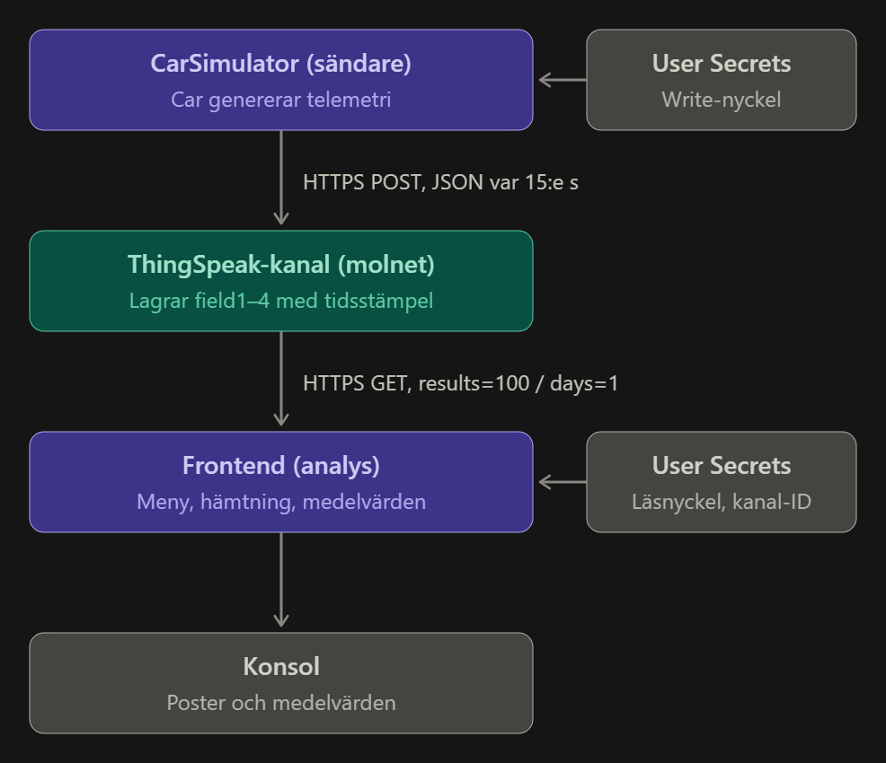
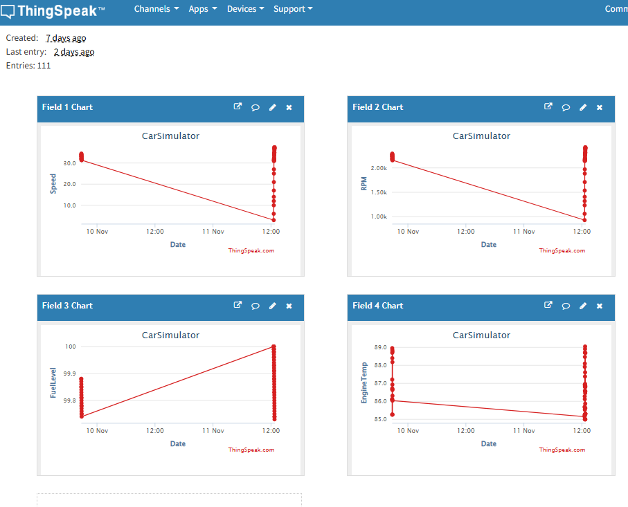

# BilSimulering – IoT-telemetri via ThingSpeak

Simulerad telemetri från en bil som skickas till molntjänsten ThingSpeak och hämtas tillbaka av ett separat analysprogram. Projektet är en inlämningsuppgift i kursen Molntjänster och IoT inom YH-utbildningen Systemutvecklare industriell IT-säkerhet.

**Teknik:** C# · .NET 8 · HttpClient · System.Text.Json · ThingSpeak REST API · User Secrets



## Köra projektet

1. Skapa en kanal på [ThingSpeak](https://thingspeak.mathworks.com) med fyra fält i ordningen Speed, RPM, FuelLevel och EngineTemp.
2. Lägg in nycklarna med **Manage User Secrets** i Visual Studio:
   - **CarSimulator:** `{ "apiKey": "<Write API Key>" }`
   - **Frontend:** `{ "apiKey": "<Read API Key>", "channelID": "<Channel ID>" }`
3. Öppna `BilSimulering.sln`, starta **CarSimulator** och låt den skicka data en stund.
4. Starta **Frontend** och välj period i menyn.

---

## 1) Inledning

Lösningen simulerar telemetri från en bil och visar hur data kan flöda från en enhet, via en molntjänst, till ett analysprogram. Syftet är att kunna följa upp förarens beteende och bilens hälsa utifrån insamlade mätvärden.

Simuleringen bygger på kursens färdiga bilsimulator ([IoT_CarSimulator](https://github.com/CKV-SM/IoT_CarSimulator)), som utökades så att den skickar hastighet, varvtal, bränslenivå och motortemperatur till molnplattformen ThingSpeak. Därefter skapades en separat konsolapplikation i C# (Frontend) som via en meny hämtar data från ThingSpeak för antingen det senaste dygnet eller de senaste 100 mätpunkterna, och räknar ut medelvärden för hastighet och varvtal.

## 2) Design och arkitektur

ThingSpeak, som valts för denna uppgift, är enkel att komma igång med, har inbyggd visualisering och passar för utbildning. Vid högre säkerhetskrav är Azure IoT Hub eller AWS IoT lämpligare. ThingSpeak använder en API-nyckel per kanal, medan Azure och AWS ger varje enhet en egen identitet, vilket gör det möjligt att spåra och spärra enskilda enheter.

Lösningen består av tre delar: en sändare (CarSimulator), en molntjänst (ThingSpeak) och ett analysprogram (Frontend). Sändaren och analysprogrammet är två separata konsolapplikationer i C# (.NET 8) i samma lösning, och de kommunicerar aldrig direkt med varandra. All data går via ThingSpeak, vilket gör att analysprogrammet kan läsa tidigare mätningar även när bilen inte är igång.

### CarSimulator

CarSimulator bygger på kursens IoT_CarSimulator. Klassen `Car` simulerar en tur på tio minuter och beräknar var 15:e sekund hastighet, varvtal, bränslenivå och motortemperatur. Värdena samlas i ett `TelemetryData`-objekt, en ögonblicksbild där fälten mappas till ThingSpeaks field1–4 med `JsonPropertyName`. Objektet skickas som JSON med ett HTTPS POST-anrop till ThingSpeaks `update.json`. Write-nyckeln läses från User Secrets i `Program.cs` och lämnas till `Car` via konstruktorn.

### ThingSpeak

ThingSpeak fungerar som IoT-hubb och databas. Kanalen lagrar varje mätning med tidsstämpel och ett löpnummer (`entry_id`), och returnerar på begäran poster som JSON, där alla fältvärden är strängar.



*ThingSpeak-kanalens fyra fält. Den raka linjen mellan körningarna är inte mätdata, utan ett streck som ThingSpeak drar mellan sista punkten i en körning och första punkten i nästa.*

### Frontend

Frontend är analysprogrammet. `Program.cs` läser läsnyckel och kanal-ID från User Secrets, kontrollerar att båda finns och skapar menyn. `Menu` låter användaren välja period, där valet översätts till parametern `results=100` (de senaste 100 posterna) eller `days=1` (senaste dygnet). Metoden `FetchAndShow` bygger adressen, gör ett HTTPS GET-anrop mot `feeds.json` och deserialiserar svaret, det vill säga gör om JSON-texten till C#-objekt, med hjälp av DTO-klasserna: `Root` för hela svaret, `Channel` för kanalinformationen och `ReadCarDTO` för varje post. Saknas data avbryts metoden med ett meddelande. Annars skrivs posterna ut och medelvärden för hastighet och varvtal beräknas. Strängvärdena omvandlas till tal med `double.TryParse` och `InvariantCulture`, eftersom ThingSpeak använder punkt som decimaltecken medan datorns svenska inställningar förväntar sig komma.

Säkerhetsaspekterna beskrivs i avsnitt 4.

## 3) Implementering

### Integration

I CarSimulator utökades klassen `TelemetryData` med `ApiKey` och `CreatedAt`, och varje egenskap kopplades till ThingSpeaks fältnamn (`api_key`, `created_at`, `field1`–`field4`) med attributet `JsonPropertyName`. Egenskaperna är init-only, eftersom en mätning inte ska kunna ändras efter att den skapats. Objektet skickas med `HttpClient.PostAsJsonAsync` till `update.json`, som serialiserar det till JSON. Fältordningen kontrollerades mot kanalens inställningar, och kursinstruktionens DTO justerades eftersom den hade hastighet och varvtal i omvänd ordning jämfört med min kanal.

I Frontend hämtas data med `GetFromJsonAsync` mot `feeds.json`, och svaret deserialiseras till DTO-klasserna `Root`, `Channel` och `ReadCarDTO`, som speglar svarets struktur. Eftersom ThingSpeak returnerar alla fältvärden som text omvandlas de till tal med `double.TryParse` och `CultureInfo.InvariantCulture`. Utan det tolkar svenska inställningar inte punkten som decimaltecken, och omvandlingen misslyckas.

Mappning till ThingSpeaks fält (CarSimulator):

```csharp
[JsonPropertyName("field1")]
public double Speed { get; init; }
```

Sändningen (CarSimulator):

```csharp
_httpClient.PostAsJsonAsync("https://api.thingspeak.com/update.json", data).Wait();
```

### Automatisering

Simulatorn kör en loop som var 15:e sekund beräknar nya värden och skickar dem utan användarens inblandning, under en tur på tio minuter. I Frontend återanvändes menystrukturen från en tidigare biblioteksuppgift. Menyvalet översätts till ThingSpeak-parametern `results=100` eller `days=1`, som skickas till en gemensam metod, `FetchAndShow`, så att samma kod hanterar båda perioderna.

Menyvalet styr hämtningen (Frontend):

```csharp
string queryAddress = $"/channels/{_channelID}/feeds.json"
    + $"?api_key={Uri.EscapeDataString(_apiKey)}&{period}";
```

### Säkerhetsåtgärder

Write- och Read-nycklarna lagras i User Secrets i respektive projekt och läses in i `Program.cs`, som skickar dem vidare via konstruktorer. Ingen nyckel finns i källkoden.

### Felhantering

Frontend kontrollerar vid start att läsnyckel och kanal-ID finns, och avbryter direkt med ett tydligt felmeddelande om de saknas. Tomt eller saknat svar från ThingSpeak hanteras med en kontroll som avslutar metoden och visar ett meddelande, i stället för att programmet kraschar. `TryParse` hoppar över värden som inte kan tolkas, och medelvärden beräknas bara om det finns minst ett giltigt värde, så att division med noll undviks. Ogiltiga menyval ger ett felmeddelande och menyn visas igen. Sändningen i CarSimulator saknar däremot felhantering.

Omvandling och felhantering (Frontend):

```csharp
if (double.TryParse(car.Speed, NumberStyles.Any, CultureInfo.InvariantCulture, out double speed))
{
    speedSum += speed;
    speedCount++;
}
```

## 4) Säkerhetsanalys och åtgärder

### Sårbarheter och risker

ThingSpeak autentiserar med en API-nyckel per kanal, inte per enhet. Den som har Write-nyckeln kan skriva till kanalen, och tjänsten kan inte avgöra om ett värde kommer från bilen eller från någon annan. På samma sätt ger en läckt Read-nyckel läsåtkomst till all data i kanalen.

Om en nyckel skrivs direkt i koden och committas finns den kvar i historiken även om den tas bort senare, och kan läsas av alla med åtkomst till repot.

Nycklar och mätvärden skickas över nätverket och skulle kunna läsas under överföringen om trafiken inte var krypterad. All kommunikation sker därför över HTTPS.

Sändaren saknar felhantering och avbryts om uppkopplingen eller ThingSpeak inte svarar. Mätvärden under avbrottet går förlorade, och analysen visar luckor som kan misstolkas, t.ex. som att bilen stått stilla.

Tomma, ofullständiga eller felaktiga svar skulle kunna få analysprogrammet att krascha eller räkna fel. Det hanteras genom kontroller av svaret och säker omvandling av värdena.

### Konsekvenser

Den som får tag på Write-nyckeln kan skicka falska mätvärden som ser ut att komma från bilen. Analysen bygger då på manipulerad data: en förare kan felaktigt pekas ut för aggressiv körning, eller ett verkligt problem som överhettning döljas av normala värden. Eftersom nyckeln inte är knuten till en enhet går det inte att avgöra i efterhand vilka värden som är äkta.

### Skydd i lösningen

ThingSpeak har separata nycklar för skrivning och läsning. Lösningen utnyttjar det genom att sändaren bara har Write-nyckeln och analysprogrammet bara Read-nyckeln, så att analysprogrammet kan läsa data men inte ändra den. Nycklarna lagras i User Secrets utanför projektmappen och kommer därför inte med i Git-repot. Analysprogrammet kontrollerar att inställningarna finns vid start, hanterar tomma svar och hoppar över värden som inte kan tolkas.

### Kvarstående risker

Att Write-nyckeln är knuten till kanalen och inte till enheten kan inte åtgärdas i ThingSpeak, utan kräver en plattform med en egen identitet per enhet, som Azure IoT Hub eller AWS IoT. CarSimulator saknar felhantering vid sändning och avbryts om uppkopplingen försvinner.

## 5) Slutsats och reflektion

### Utmaningar

En av utmaningarna var att få data att hamna rätt mellan programmen. Kursinstruktionens DTO hade hastighet och varvtal i omvänd ordning jämfört med min kanal, vilket hade gett felaktiga värden utan felmeddelande. En annan utmaning var att förstå varför värden från ThingSpeak måste omvandlas med `InvariantCulture`: ThingSpeak använder punkt som decimaltecken, medan datorns svenska inställningar förväntar sig komma.

### Lärdomar

Jag har fått en bra bild av hur ett IoT-flöde fungerar, från enhet via molntjänst till analys, och hur JSON mappas till C#-klasser. Jag har lärt mig skillnaden mellan att lagra en hemlighet och att använda den, varför mätvärden bör vara oföränderliga ögonblicksbilder, och varför data från ett externt system alltid ska kontrolleras innan den används. En bra lärdom är också att saknad data inte är samma sak som ett mätvärde.

### Vidareutveckling och förbättringar

Sändaren bör få felhantering som buffrar mätvärden lokalt när uppkopplingen saknas och skickar dem senare. Analysprogrammet bör delas upp enligt Single Responsibility-principen, med hämtningen i en egen klass och analysen i en annan klass, vilket gör det lättare att byta molntjänst och att testa analysen. Analysen kan byggas ut med de frivilliga delarna, upptäckt av aggressiv körning, överhettning och felkoder, eftersom medelvärden ensamma säger lite om förarens beteende och bilens hälsa. Vid högre säkerhetskrav bör ThingSpeak ersättas med en plattform som ger varje enhet en egen identitet.

---

Koden är kommenterad, och kommentarerna har lämnats kvar för att förklara hur de olika delarna fungerar och varför vissa val har gjorts.

*Kristian Lind Howard*
